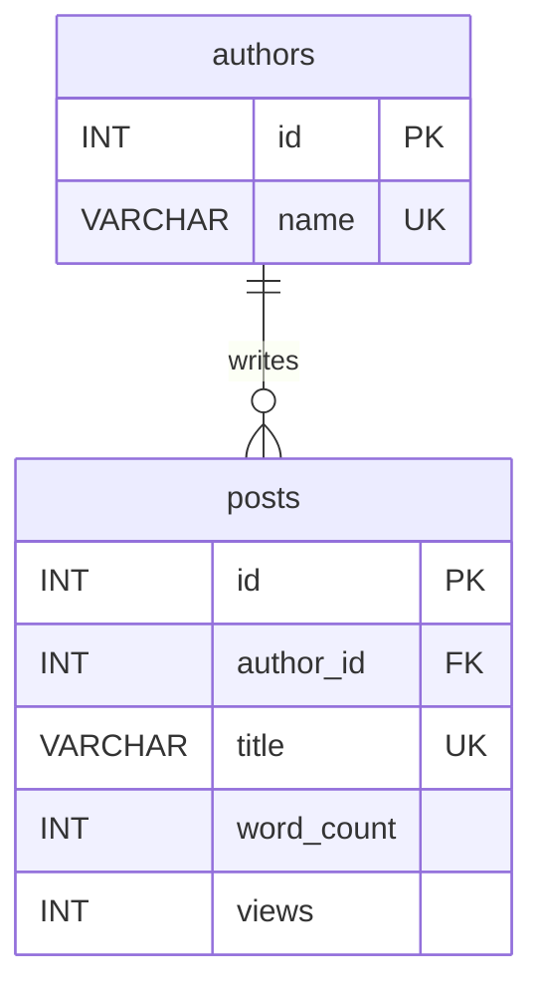
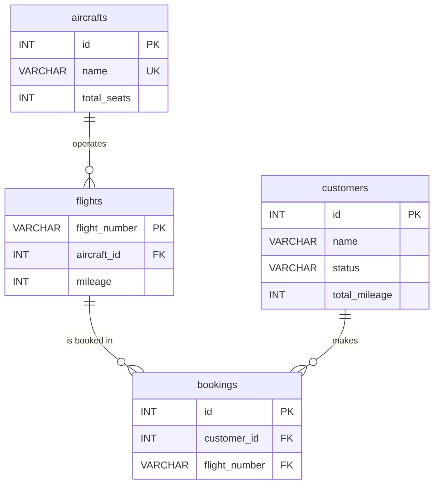

# LAB | SQL Normalización, DDL y Agregación

### Instrucciones

1. Haz un fork de este repositorio.
2. Clona tu fork en tu máquina local.
3. Resuelve los ejercicios a continuación.

## Entregables

- Cuando termines, añade tu solución a git.
- Haz commit de los cambios y súbelos a tu repositorio en GitHub.
- Crea un pull request y pega el enlace del PR en el campo de entrega del Student Portal.

## Ejercicio 1: Normalizar una base de datos de blogs

**Paso 1:** A partir del siguiente conjunto de datos sin normalizar, identifica redundancias y normalízalo (al menos hasta 3FN).

<br>

| **author**          | **title**                       | **word_count** | **views** |
|----------------|-----------------------------|------------|-------|
| Maria Charlotte  | Best Paint Colors             | 814              | 14      |
| Juan Perez       | Small Space Decorating Tips   | 1146             | 221     |
| Maria Charlotte  | Hot Accessories               | 986              | 105     |
| Maria Charlotte  | Mixing Textures               | 765              | 22      |
| Juan Perez       | Kitchen Refresh               | 1242             | 307     |
| Maria Charlotte  | Homemade Art Hacks            | 1002             | 193     |
| Gemma Alcocer    | Refinishing Wood Floors       | 1571             | 7542    |

<br>

**Paso 2:** Escribe los scripts DDL (`CREATE TABLE`) para implementar tu esquema normalizado.

**Paso 3 (Opcional):** Inserta los datos de ejemplo usando `INSERT INTO`.

## Ejercicio 2: Normalizar una base de datos de vuelos

**Paso 1:** Normaliza el siguiente conjunto de datos (mínimo hasta 3FN):

<br>

| **Customer Name**    | **Customer Status** | **Flight Number** | **Aircraft**    | **Total Aircraft Seats** | **Flight Mileage** | **Total Customer Mileage** |
| ---------------- | --------------- | ------------- | ----------- | -------------------- | -------------- | ---------------------- |
| Agustine Riviera | Silver          | DL143         | Boeing 747  | 400                  | 135            | 115235                 |
| Agustine Riviera | Silver          | DL122         | Airbus A330 | 236                  | 4370           | 115235                 |
| Alaina Sepulvida | None            | DL122         | Airbus A330 | 236                  | 4370           | 6008                   |
| Agustine Riviera | Silver          | DL143         | Boeing 747  | 400                  | 135            | 115235                 |
| Tom Jones        | Gold            | DL122         | Airbus A330 | 236                  | 4370           | 205767                 |
| Tom Jones        | Gold            | DL53          | Boeing 777  | 264                  | 2078           | 205767                 |
| Agustine Riviera | Silver          | DL143         | Boeing 747  | 400                  | 135            | 115235                 |
| Sam Rio          | None            | DL143         | Boeing 747  | 400                  | 135            | 2653                   |
| Agustine Riviera | Silver          | DL143         | Boeing 747  | 400                  | 135            | 115235                 |
| Tom Jones        | Gold            | DL222         | Boeing 777  | 264                  | 1765           | 205767                 |
| Jessica James    | Silver          | DL143         | Boeing 747  | 400                  | 135            | 127656                 |
| Sam Rio          | None            | DL143         | Boeing 747  | 400                  | 135            | 2653                   |
| Ana Janco        | Silver          | DL222         | Boeing 777  | 264                  | 1765           | 136773                 |
| Jennifer Cortez  | Gold            | DL222         | Boeing 777  | 264                  | 1765           | 300582                 |
| Jessica James    | Silver          | DL122         | Airbus A330 | 236                  | 4370           | 127656                 |
| Sam Rio          | None            | DL37          | Boeing 747  | 400                  | 531            | 2653                   |
| Christian Janco  | Silver          | DL222         | Boeing 777  | 264                  | 1765           | 14642                  |

<br>

**Paso 2:** Identifica las dependencias funcionales y descompón el esquema en tablas más pequeñas relacionadas:
- `customers`
- `flights`
- `aircrafts`
- `bookings`

**Paso 3:** Escribe los scripts DDL (`CREATE TABLE` + claves foráneas).

**Paso 4:** Inserta los datos de ejemplo.

## Ejercicio 3: Consultas SQL sobre la base de datos de vuelos

Usa el esquema que creaste en el ejercicio 2 para responder lo siguiente:

1. Número total de vuelos:
```sql
SELECT COUNT(DISTINCT flight_number) FROM flights;
```

2. Distancia media de los vuelos:
```sql
SELECT AVG(mileage) FROM flights;
```

3. Número medio de plazas por avión:
```sql
SELECT AVG(total_seats) FROM aircrafts;
```

4. Millas medias recorridas por los clientes, agrupadas por estado:
```sql
SELECT status, AVG(total_mileage) FROM customers GROUP BY status;
```

5. Máximo de millas recorridas por clientes, agrupadas por estado:
```sql
SELECT status, MAX(total_mileage) FROM customers GROUP BY status;
```

6. Número de aviones con el nombre \"Boeing\":
```sql
SELECT COUNT(*) FROM aircrafts WHERE name LIKE '%Boeing%';
```

7. Vuelos con distancia entre 300 y 2000 millas:
```sql
SELECT * FROM flights WHERE mileage BETWEEN 300 AND 2000;
```

8. Distancia media de vuelos **reservados**, agrupada por estado del cliente:
```sql
SELECT c.status, AVG(f.mileage)
FROM bookings b
JOIN customers c ON b.customer_id = c.id
JOIN flights f ON b.flight_number = f.flight_number
GROUP BY c.status;
```

9. Avión más reservado por miembros con estado Gold:
```sql
SELECT a.name, COUNT(*) AS total_bookings
FROM bookings b
JOIN customers c ON b.customer_id = c.id
JOIN flights f ON b.flight_number = f.flight_number
JOIN aircrafts a ON f.aircraft_id = a.id
WHERE c.status = 'Gold'
GROUP BY a.name
ORDER BY total_bookings DESC
LIMIT 1;
```

## Reto Extra

- Crea diagramas ERD para visualizar ambos esquemas.
- Usa restricciones `CHECK`, `NOT NULL` y `UNIQUE` donde sea apropiado.
- Añade índices (`INDEX`) donde creas que puede mejorar el rendimiento.

<br>

**¡Disfruta del análisis de datos con SQL!** :dart:

---

## Solution

All scripts target **MySQL 8.0.16+** (the version where `CHECK` constraints started being enforced) and live in [`sql/`](sql/). Each DDL script drops and recreates its own database (`blog_db`, `airline_db`), so the scripts can be re-run safely. Run them in this order:

| Script | Content |
|---|---|
| [`sql/01-blog-ddl.sql`](sql/01-blog-ddl.sql) | Exercise 1: `blog_db` schema |
| [`sql/02-blog-data.sql`](sql/02-blog-data.sql) | Exercise 1: sample data + a join that rebuilds the original table |
| [`sql/03-airline-ddl.sql`](sql/03-airline-ddl.sql) | Exercise 2: `airline_db` schema with foreign keys |
| [`sql/04-airline-data.sql`](sql/04-airline-data.sql) | Exercise 2: sample data + a join that rebuilds the original table |
| [`sql/05-airline-queries.sql`](sql/05-airline-queries.sql) | Exercise 3: the nine queries, with expected results |

From a terminal: `mysql -u root -p < sql/01-blog-ddl.sql` (and so on), or open each file in MySQL Workbench and execute it.

### Exercise 1: blog normalization

The raw table repeats the author name on every post. Each title determines its word count and views, and the author is a separate entity that writes many posts (one-to-many). Moving authors to their own table removes the redundancy and leaves no partial or transitive dependencies (3NF).



### Exercise 2: airline normalization

Functional dependencies found in the raw table:

- `customer_name -> customer_status, total_customer_mileage`
- `flight_number -> aircraft, flight_mileage`
- `aircraft -> total_aircraft_seats` (transitive through the flight, so it gets its own table)

Each remaining row only says "this customer booked this flight", which becomes `bookings`. Design decisions worth noting:

- **`bookings` has a surrogate `id`.** The data contains identical rows (Agustine Riviera on DL143 four times, Sam Rio on DL143 twice), so a composite `(customer_id, flight_number)` key would reject them. All 17 bookings are kept.
- **`total_mileage` is stored on `customers`.** It cannot be computed from the bookings (Agustine's bookings add up to 4,910 miles, not 115,235), so it is the customer's lifetime mileage rather than a derived value.
- **`status` is a constrained string** (`CHECK (status IN ('None', 'Silver', 'Gold'))`). `'None'` is kept as a real status value so it shows up as its own group in the `GROUP BY status` queries.
- Column names (`flights.mileage`, `flights.aircraft_id`, `aircrafts.total_seats`, `customers.total_mileage`, `bookings.customer_id`...) match the queries given in Exercise 3, so those queries run unchanged.



### Exercise 3: query results

Verified by running the scripts on MySQL 8.4:

| # | Query | Result |
|---|---|---|
| 1 | Total number of flights | 5 |
| 2 | Average flight distance | 1775.8 |
| 3 | Average seats per aircraft | 300 |
| 4 | Average customer mileage by status | Gold 253174.5, None 4330.5, Silver 98576.5 |
| 5 | Max customer mileage by status | Gold 300582, None 6008, Silver 136773 |
| 6 | Aircrafts with "Boeing" in the name | 2 |
| 7 | Flights between 300 and 2000 miles | DL37 (531), DL222 (1765) |
| 8 | Average booked distance by status | Gold 2494.5, None 1292.75, Silver 1438.33 |
| 9 | Most booked aircraft among Gold members | Boeing 777 (3 bookings) |

### Extra challenge

- **ERDs:** the two Mermaid diagrams above (GitHub renders them).
- **Constraints:** `NOT NULL` on every column; `UNIQUE` on `authors.name`, `posts.title` and `aircrafts.name`; `CHECK` on word counts, views, seats, mileage and customer status. Inserts that break them (an unknown status, a negative view count, a booking for a flight that does not exist, a duplicate aircraft) are rejected.
- **Indexes:** on every foreign key column (`posts.author_id`, `flights.aircraft_id`, `bookings.customer_id`, `bookings.flight_number`) for the joins, on `customers.status` for the `GROUP BY status` / `WHERE status = 'Gold'` queries, and on `flights.mileage` for the `BETWEEN` range filter. On a dataset this small MySQL may still choose a full scan; the indexes matter as the tables grow.
